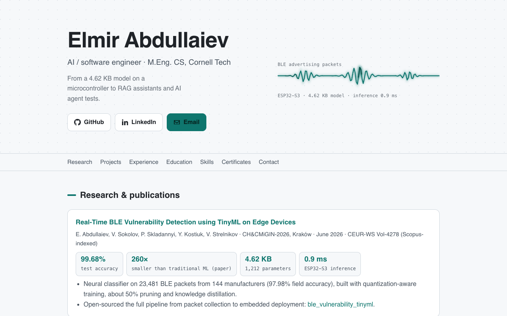

# elmir132.github.io

Source of my portfolio site, [elmirabd.me](https://elmirabd.me): research, projects, experience, education, skills and certificates on one page.

## How it is built

A single static page. There is no build step and no framework: `index.html` holds the markup and the styles, with no JavaScript, and it supports light and dark mode and phone widths. It is served by GitHub Pages on the custom domain in `CNAME`.

| Path | What it is |
|---|---|
| `index.html` | the page |
| `img/` | project screenshots used on the cards |
| `og-image.png` | the image shown when the link is shared |
| `*.png` (certificates) | certificate images linked from the page |
| `robots.txt`, `sitemap.xml` | search engine files |

To preview it locally: `python3 -m http.server` in this folder, then open http://localhost:8000.

## License

The **code** (HTML, CSS and JavaScript) is MIT licensed, see [`LICENSE`](LICENSE). The **text, photos, certificates and project screenshots** are mine and are not covered by that license: all rights reserved.
